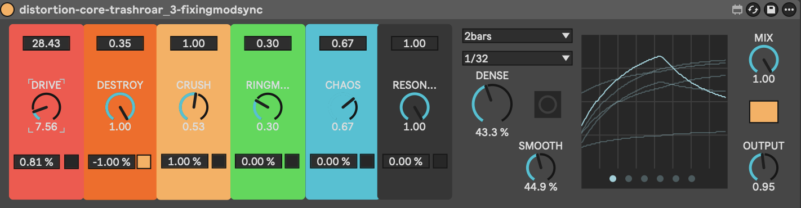
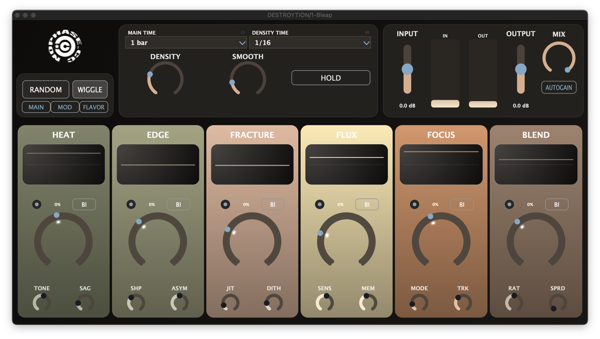

## Summary
Destroytion is a native JUCE stereo distortion plugin focused on animated
destruction, rhythmic motion, and aggressive but playable timbral control. The
prototype is already running as a real VST3 with custom DSP and a purpose-built
editor, not just a concept patch. Under the hood it pairs tempo-synced random
modulation with a multi-stage nonlinear DSP path.

## Snapshot
- Status: prototype in active iteration (active JUCE prototype)
- Format: native JUCE stereo VST3 effect
- Stack: JUCE and C++
- Current editor size: `1080 x 572`
- Focus: animated destruction with rhythmic motion and a strong musical middle

## What It Is
- HEAT
- EDGE
- FRACTURE
- FLUX
- FOCUS
- BLEND

Those six strips define the main sound-shaping identity of the plugin. The
project is built around tempo-synced random modulation, custom per-channel DSP,
and a performance-oriented editor rather than a generic distortion layout.

## Current Direction
- Preserve a musical mid-range before extreme breakup
- Improve voicing at high settings
- Continue UI clarity and real-time playability improvements

## Gallery





## Technical Docs
Implementation details, architecture, and code excerpts for Destroytion.

### Architecture
The working plugin is split into four main runtime pieces:

- `Source/PluginProcessor.*`: host integration, parameter layout, audio block loop, metering, state save/restore
- `Source/DestroytionParamResolver.*`: fast parameter reads from APVTS and final modulation application
- `Source/ccModulator.*`: transport sync, trigger timing, random target generation, smoothing
- `Source/DestroytionChannel.*`: per-channel DSP state and distortion stages

That structure keeps the audio callback readable. The processor coordinates the
system, while the modulation and DSP logic live in focused modules.

### Strip Roles

- `HEAT`: drive and saturation body
- `EDGE`: fold and destruction intensity
- `FRACTURE`: crush, hold, jitter, and dither character
- `FLUX`: ringmod and chaos motion
- `FOCUS`: filter tone and tracking behavior
- `BLEND`: body versus texture recombination

At a high level, the audio path is:

`Transport -> Modulation -> Parameter Resolve -> Input Trim -> Per-Channel DSP -> Autogain -> Mix -> Output`

### Implementation Notes
Each sample follows the same block-processing rhythm:

```cpp
const auto stepData = paramResolver.readStepData();

ccModulator::StepInput modInput;
modInput.mainRateIndex = stepData.mainRateIndex;
modInput.densityRateIndex = stepData.densityRateIndex;
modInput.densityAmount = stepData.densityAmount;
modInput.smooth = stepData.smooth;
modInput.holdMod = stepData.holdMod;
modulator.processSample(modInput);

const DestroytionParamSet p =
    paramResolver.buildModulatedParams(stepData, modulator.getCurrentValues());
```

After modulation resolves, the processor trims input, runs the left and right
channels independently, estimates loudness, and applies optional autogain:

```cpp
const float wetL = leftChannel.process(dryLeft, p, ringPhase, 0.0f, sr, rng);
const float wetR = rightChannel.process(dryRight, p, ringPhase, 0.25f, sr, rng);

const float gainComp = clipf(inputLevel / outputLevel, 0.25f, 4.0f);
const float targetGain = p.autogain ? gainComp : 1.0f;
smoothGain = smoothGain * 0.9995f + targetGain * 0.0005f;
```

That gain smoothing is important because the effect can move through radically
different nonlinear states very quickly.

The modulation system is host-aware. If the DAW provides PPQ position, the
plugin uses it. If not, it falls back to free-running phase accumulation.

```cpp
if (hasPpqSync)
{
    ppq = ppqStart + static_cast<double>(sampleIndexInBlock) * ppqPerSample;
}
else
{
    ppq = freeRunPpq;
    freeRunPpq += ppqPerSample;
}
```

Two trigger layers drive the movement:

- `MAIN TIME` produces guaranteed structure
- `DENSITY TIME` produces optional extra events

When a trigger fires, the modulator generates six new random targets, one for
each major strip. `SMOOTH` then turns abrupt jumps into slewed motion:

```cpp
const float fastToSlow = std::pow(smoothNorm, 3.0f);
const float tauMs = juce::jmap(fastToSlow, 4.0f, 3200.0f);
const float tauSamples = juce::jmax(1.0f, (tauMs * 0.001f) * static_cast<float>(sr));
const float slew = 1.0f - std::exp(-1.0f / tauSamples);
```

This is one of the core ideas in Destroytion: motion is not a side feature, it
is part of the sound design model itself.

The modulator only outputs six normalized values. `DestroytionParamResolver`
translates those into actual strip values while respecting parameter ranges,
user modulation amount, and bipolar versus unipolar polarity.

```cpp
if (stepData.unipolar[i])
    offset = modValues[i] * modRange;
else
    offset = ((modValues[i] * 2.0f) - 1.0f) * modRange;

if (modAmount < 0.0f)
    offset = -offset;

*values[i] = clipf(*values[i] + offset, minVals[i], maxVals[i]);
```

That keeps the UI expressive without letting modulation push parameters into
nonsense states.

The per-channel DSP path is where the plugin gets its voice.

#### HEAT
`HEAT` is more than simple gain. It applies input-dependent sag and blends
different saturation shapes:

```cpp
const float heatDrive = driveToGain(p.heat);
const float sagScale = 1.0f / (1.0f + p.driveSag * 1.8f * c.driveEnv);
const float pre = signal * heatDrive * sagScale;
const float smoothSat = softClip(pre * 0.68f) + 0.22f * softClip(pre * 0.2f);
const float denseSat = softClip((pre + colorAsym) * 1.06f) - softClip(colorAsym * 1.06f) * 0.58f;
```

#### EDGE
`EDGE` pushes the signal into a controllable folding stage rather than just
adding more generic clipping:

```cpp
const float edgeFolded = foldBlend(bodyBase + edgeBias, p.edge * 0.9f, edgeShape) - edgeBias * 0.2f;
const float edgeMix = std::pow(p.edge, 0.8f);
const float body = juce::jmap(edgeMix, bodyBase, edgeFolded);
```

#### FRACTURE
`FRACTURE` combines bit reduction, sample-and-hold timing, jitter, and dither:

```cpp
if (--c.crushCounter <= 0)
{
    const int baseHold = 1 + juce::roundToInt(rateNorm * 70.0f);
    const float jitter = (rng.nextFloat() * 2.0f - 1.0f) * jitterRange;
    c.crushCounter = juce::jmax(1, baseHold + juce::roundToInt(jitter));
    const float dither = (rng.nextFloat() * 2.0f - 1.0f) * (p.crushDither / bitSteps);
    c.crushHold = std::floor((texture + dither) * bitSteps + 0.5f) / bitSteps;
}
```

#### FLUX
`FLUX` moves between amplitude modulation, ring modulation, and chaotic
feedback-influenced behavior:

```cpp
const float ratio = ratioFromNorm(p.ringRatio + (rng.nextFloat() - 0.5f) * 0.08f * fluxMotion);
const float carrierHz = (26.0f + std::pow(p.flux, 1.05f) * 160.0f) * ratio;
const float ringOsc = std::sin(phase * juce::MathConstants<float>::twoPi);
const float ringBlend = juce::jmap(p.flux, am, ring);
```

#### FOCUS And BLEND
`FOCUS` uses a simple state-variable style filter to move between low-pass,
band-pass, and high-pass regions, while `BLEND` recombines body and texture
energy before the final output stage.

```cpp
const float hp = combined - c.svfLp - damp * c.svfBp;
c.svfBp += f * hp;
c.svfLp += f * c.svfBp;
```

### Current Focus
- Keep animated destruction behavior musically usable
- Preserve a strong mid-range before extreme breakup
- Improve real-time modulation clarity for performance
