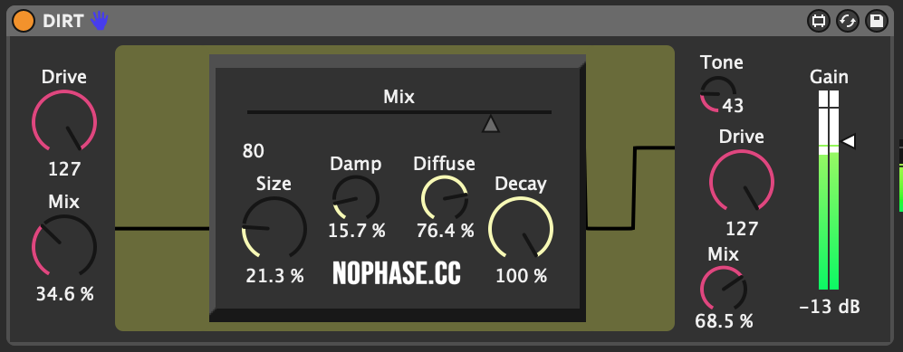

## Summary
Dirt is a NOPHASE Max for Live device focused on destructive tone shaping,
non-linear behavior, and controlled unpredictability, designed for creative
destruction, instability, and unconventional audio texture.

## Snapshot
- Status: active development
- Format: Max for Live audio device
- Platform: Ableton Live (Ableton-centered audio processing workflow)
- Focus: character-first destruction rather than transparent utility processing; non-linear coloration, unstable texture, and character-first control

## What It Is
- Audio destruction and coloration
- Non-linear, character-first response
- Creative instability as a feature

## Current Direction
- Module design and control mapping
- Preset voicing and workflow clarity
- Release packaging and documentation

## Gallery

## Technical Docs
Implementation details, architecture, and code excerpts for Dirt.

### Architecture
The current prototype appears to be organized around a few clear control zones:

- left-side drive and blend staging
- a central texture or space block with `Mix`, `Size`, `Damp`, `Diffuse`, and `Decay`
- right-side tone and gain/output shaping

That layout suggests a design that combines front-end destruction with a
centralized diffusion or ambience stage and final tone/output management.

### Key Systems
- destructive drive and coloration
- parallel or staged mix control
- tone shaping and final gain management
- diffusion-style space controls for unstable, smeared texture

### Implementation Notes
This docs page is still early compared with the JUCE and app projects. The goal
for the next pass is to turn the current interface and patch structure into:

- a parameter reference
- a signal-flow breakdown
- Ableton routing examples
- notes on quirks, voicing, and intended use

### Current Focus
- Module design and signal character tuning
- Control mapping and workflow polish
- Preset strategy and release packaging
