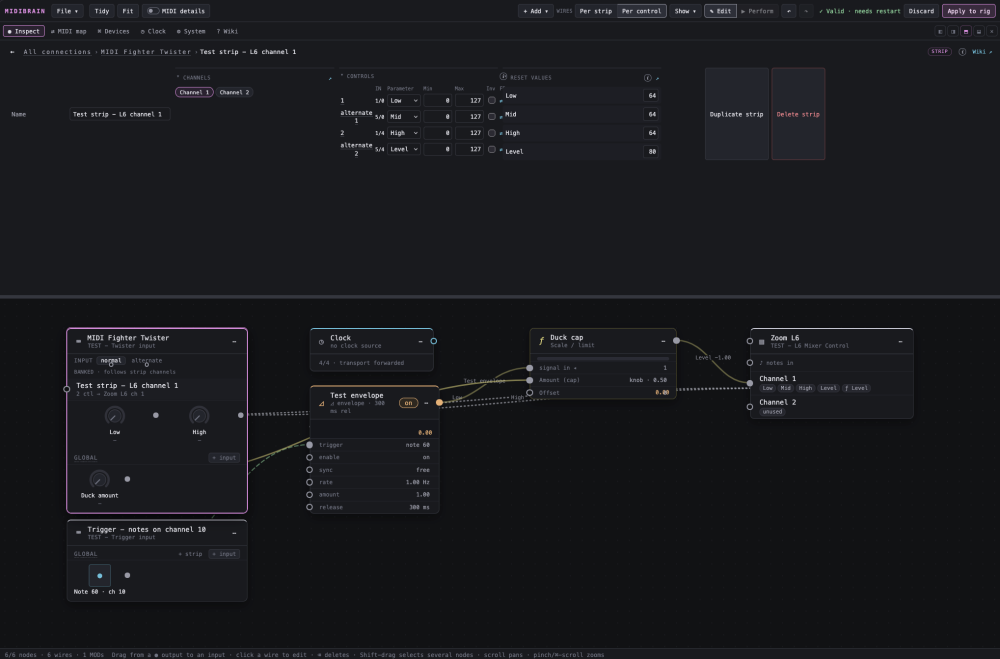
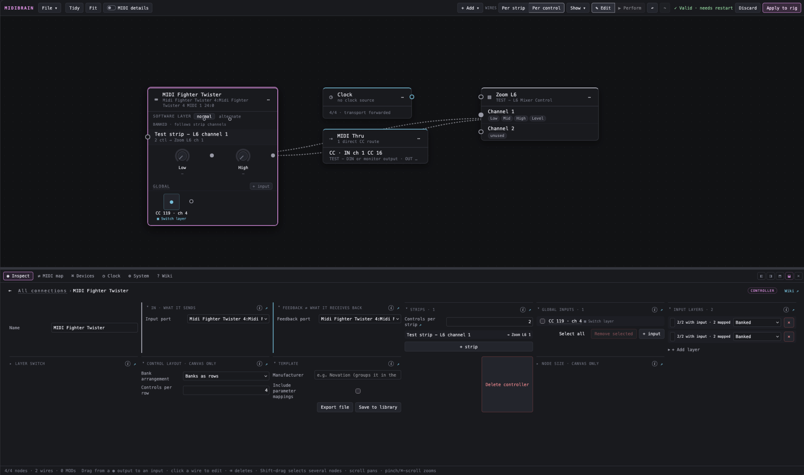
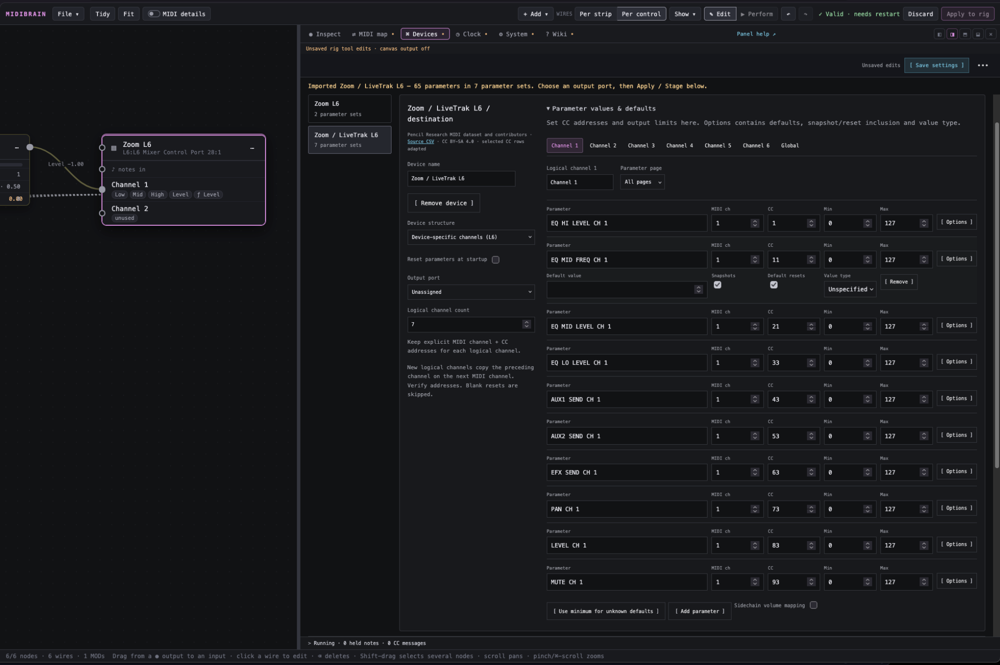
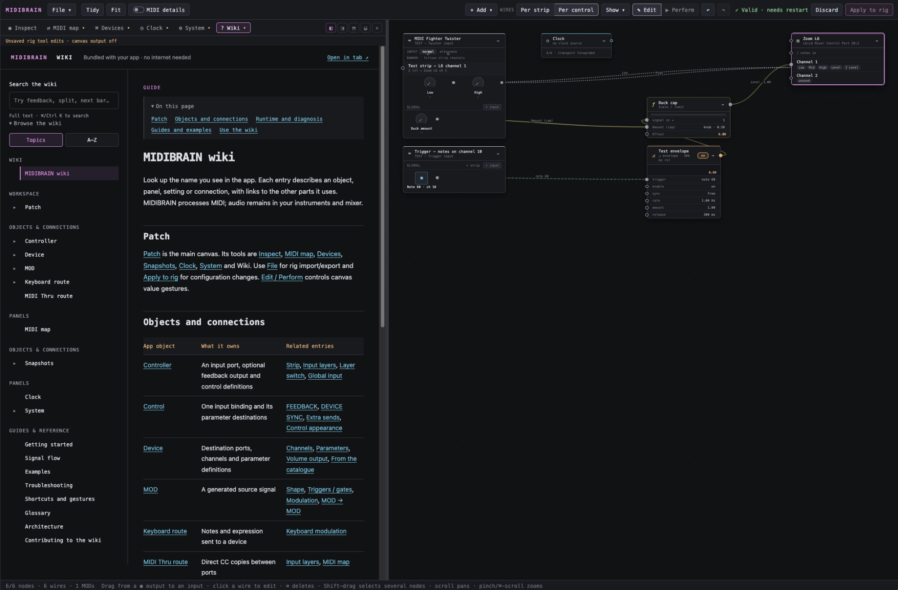
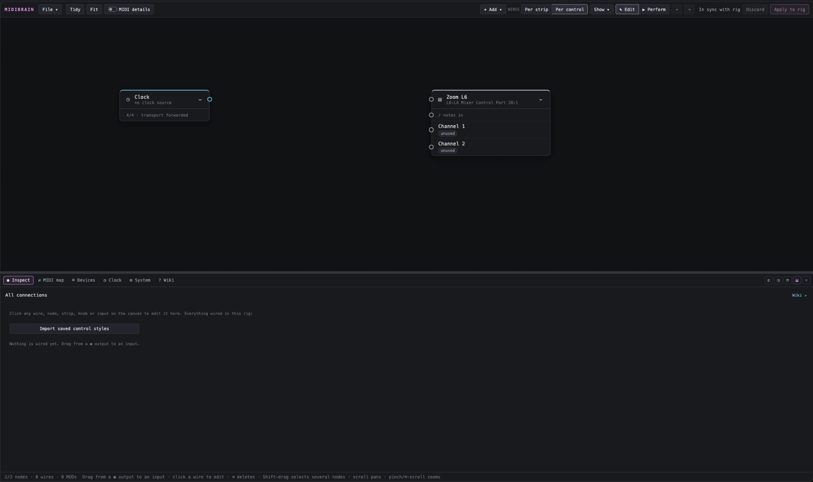

## Summary

MIDIBRAIN sits between your controllers and your instruments. You build the rig
in a browser, on a node canvas: controllers, MODs, operators, snapshots, a clock
and destination devices, joined by wires. Press **Apply to rig** and it keeps
running on a Raspberry Pi or your laptop with the browser closed.

It only handles MIDI. Audio stays in your instruments and mixer.

**0.1.0 is the first public release.** The code is on
[GitHub](https://github.com/clewis10/midibrain). It is early and has been tested
on a small set of hardware, so expect rough edges.


_A rig on the canvas: a MIDI Fighter Twister strip drives a Zoom L6 channel, while a note-triggered envelope ducks the channel level through a "Duck cap" operator._

## Try it without hardware

Demo mode simulates devices, so you can build a full rig before plugging
anything in. You need Python 3.11 or newer. On Linux, install the ALSA headers
first (`sudo apt install libasound2-dev`).

```bash
git clone https://github.com/clewis10/midibrain.git
cd midibrain
python3 -m venv .venv
.venv/bin/pip install -e .
.venv/bin/midibrain-mixer demo --web --port 8791
```

Then open `http://127.0.0.1:8791/`. The built-in wiki is at `/manual`.

For a Raspberry Pi 4 or 5, follow the
[Pi guide](https://github.com/clewis10/midibrain/blob/main/docs/RASPBERRY_PI.md).
It covers listing ports, a first manual run and starting on boot with systemd.

## Snapshot

- Status: public alpha, v0.1.0
- Runs on: Raspberry Pi (Ubuntu or Raspberry Pi OS) and desktop
- Stack: Python, `mido` + `python-rtmidi`, FastAPI, and a plain HTML/CSS/JS interface
- Storage: JSON rig files. No database, cloud service or Node build step.
- Source: [github.com/clewis10/midibrain](https://github.com/clewis10/midibrain)

## What's in 0.1

- **Patch canvas.** The rig *is* the graph. Every node and wire maps to the
  saved configuration, so there is no second routing model to keep in sync.
  **Edit** mode configures, **Perform** mode sends live values from the canvas.
- **Controllers.** Strips of knobs and faders, up to eight input layers (banked
  or direct), MIDI layer switching, global buttons and keys, plus value feedback
  to LED rings and motor faders.
- **Devices.** Channels and named parameters with ranges, defaults and reset
  rules. CC maps import from the [Pencil Research MIDI dataset](https://midi.guide)
  catalogue.
- **MODs.** Sine, triangle, saw, square, random (sample-and-hold with slew) and
  envelopes. Free-running or synced to clock, looped, triggered or one-shot.
  MODs can modulate other MODs. Note-triggered envelopes on a volume curve give
  you MIDI sidechain ducking.
- **Operators.** Small math nodes: sum, average, multiply, min/max, scale and
  limit, curve, quantize to a scale, and smoothing.
- **Keyboard routes.** Key splits, transpose, scale quantize, fixed velocity and
  expression pass-through. Every route setting can be modulated.
- **MIDI Thru.** Direct CC copies between ports with remapping, scaling and
  inversion.
- **Snapshots.** Capture and recall parameter states from controller buttons,
  either instantly or queued to land on the one.
- **Clock.** Follows incoming MIDI clock for synced MODs and next-bar actions,
  and forwards transport to other gear.
- **Built-in wiki.** Searchable, bundled with the app and works offline. Every
  inspector panel links to its entry.

## Gallery


_Controller inspector: input and feedback ports, strips, global inputs and input layers. A MIDI Thru route copies one CC straight to the mixer._


_Devices: a Zoom LiveTrak L6 imported from the catalogue, 65 parameters in 7 sets, with per-parameter MIDI channel, CC, range and defaults._


_The wiki opens beside the canvas and needs no internet connection._


_A new rig starts almost empty: a clock and whatever devices you add._

## Known limits in 0.1

- 7-bit CC only. NRPN and 14-bit CC rows are skipped on import.
- No pickup mode yet, so fixed-position knobs can jump after a snapshot recall.
  Encoders that accept feedback are fine.
- Keyboard note routes work in the demo but have not been tested on hardware.
- The web UI has no login. Only bind to `0.0.0.0` on a network you trust, or
  reach the Pi through an SSH tunnel.

The old roadmap for this project (a modulation runtime, scene recall and
controller feedback) all shipped in this release as MODs, snapshots and
FEEDBACK. What comes next depends on what breaks on more hardware, so bug
reports with your controller and device models are the most useful thing you
can send.

## Technical Docs

How MIDIBRAIN is put together. The repository's
[`docs/ENGINE_ARCHITECTURE.md`](https://github.com/clewis10/midibrain/blob/main/docs/ENGINE_ARCHITECTURE.md)
goes deeper.

### Architecture

- **Python 3.11+** handles timing, state, configuration and routing.
- **mido** with the **python-rtmidi** backend talks to the operating system's
  MIDI stack.
- **FastAPI** and **Uvicorn** serve the editor and its API from a background
  thread when `--web` is on.
- The browser interface is plain JavaScript, HTML and CSS, with no framework or
  build pipeline.
- Rigs are saved as JSON, with snapshots in a separate sidecar file.
- On a Pi, **systemd** starts the process on boot and restarts it if it exits.

The main thread runs MIDI processing. Web handlers and the runtime share a
session behind a reentrant lock, and a separate writer thread persists snapshot
captures. Closing the browser leaves the engine running.

### Following one knob turn

1. The runtime polls the input port and receives a control change.
2. Diagnostics record it, and MIDI learn gets a chance to observe it.
3. Explicit MIDI Thru routes are handled by the port router. Controller roles
   also feed the bank engine. These are separate paths.
4. The bank engine finds the binding by controller, MIDI channel and CC.
5. The binding picks its destination parameters, scales or inverts the value
   within their limits, and updates their base values.
6. Active MODs are combined with those base values. Volume ducking uses its own
   attenuation curve instead of treating CC values as linear gain.
7. Output is rounded to 7-bit, unchanged values are suppressed, and the pending
   queue keeps only the latest value per destination, channel and CC.
8. The runtime drains that queue to the MIDI outputs. Controller feedback goes
   through the same queued path.

Note-on messages can trigger MOD envelopes, with velocity setting the strength
and note-off starting the release. Scheduled ticks keep LFOs and envelopes
moving when no new MIDI arrives. Clock and transport are forwarded as ordered
events and are never coalesced like parameter values.

### Applying changes safely

Canvas edits are a draft until you press **Apply to rig**. Apply validates the
whole setup first and checks the configuration revision, so an older browser tab
cannot silently overwrite a newer edit. Structural changes (devices, strips,
ports, routing) are saved and staged for a controlled runtime restart.
MOD-only changes apply without one. Live values, saved configuration, snapshots
and canvas layout are stored separately, so a saved-looking screen is never
mistaken for an active hardware change.

### Running on a Pi

```bash
.venv/bin/midibrain-mixer ports
cp config/performance.example.json config/performance.local.json
.venv/bin/midibrain-mixer run --config config/performance.local.json \
  --allow-unverified --web --host 0.0.0.0 --port 8788
```

`scripts/install_service.sh` installs the systemd unit, and
`journalctl -u midibrain -f` follows the logs. To keep the editor off the
network, leave out `--host 0.0.0.0` and use a tunnel instead:

```bash
ssh -N -L 8788:127.0.0.1:8788 user@pi
```

### Repository map

- `src/midibrain/performance/`: the application (`midibrain-mixer`)
- `src/midibrain/performance/manual/`: the wiki's Markdown sources
- `docs/`: Pi setup, the patch canvas, snapshots and modulation, engine notes
- `tests/`: Python unit tests, browser tests for the canvas and wiki, and
  `tests/pi-rigs/` hardware acceptance rigs with a checklist

Run the tests with:

```bash
.venv/bin/pip install -e '.[test]'
.venv/bin/python -m unittest discover -s tests -p 'test_*.py'
```
