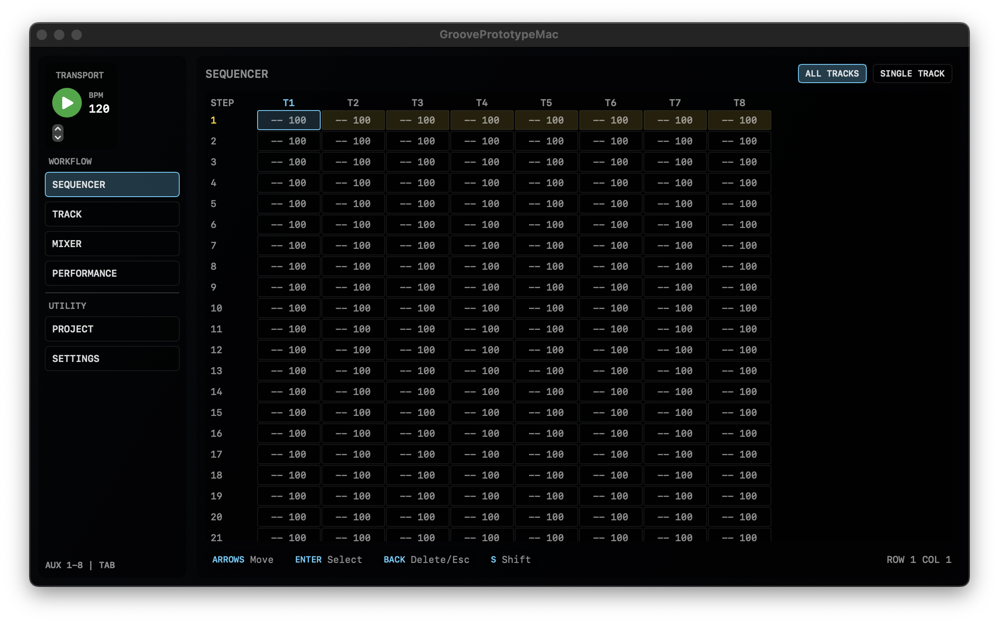
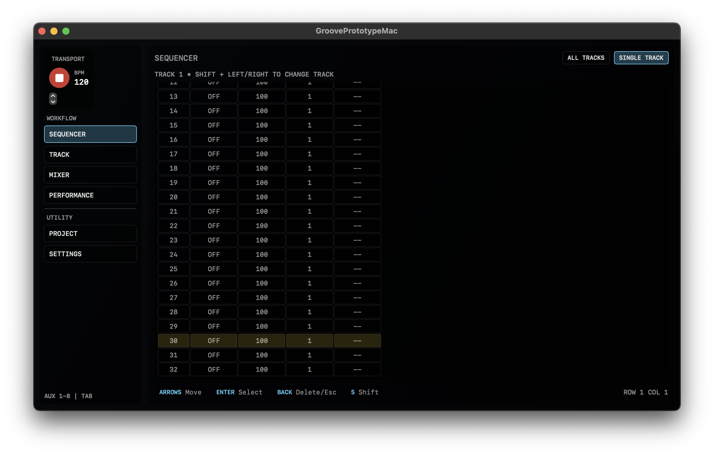

## Summary
CCGROOVE is a working groove box prototype built around a tracker-style step
model, keyboard-first navigation, and a shared SwiftUI interface that runs on
macOS and can scale toward iOS. It has a controller-first interaction model
aimed at fast pattern entry on macOS first, then iOS.

## Snapshot
- Status: playable prototype in active development (working prototype)
- Format: Apple-platform groove box app
- Targets: macOS now with iOS-ready shared UI architecture
- Stack: SwiftUI with separated sequencing and engine layers
- Sequencer size: 32 steps, 8 tracks
- Editing modes: all tracks and single track
- Step data: trigger, velocity, ratchet

## What It Is
- 32-step pattern model with 8 tracks
- All-tracks and single-track sequencer views
- Per-step trigger, velocity, and ratchet editing
- Keyboard navigation mapped to movement, select, back, transport, and aux actions
- Shared view model driving transport, cursor state, section changes, and playback callbacks

## Current Direction
- SwiftUI UI layer shared across Apple targets
- Sequencer model lives in separate data types rather than being embedded in views
- Drum engine abstraction already exists, so AudioKit or a future native engine can swap in without changing editor behavior
- Longer-term direction is still a dedicated C++ audio engine once the workflow solidifies

## Gallery





## Technical Docs
Implementation details, architecture, and code excerpts for CCGROOVE.

### Architecture
The app is already split into a few clean layers:

- `Shared/Sequencer`: pattern, track, step, and transport timing
- `Shared/UI`: root views, section views, grid rendering, and the main interaction state machine
- `Shared/Engine`: the drum-engine boundary, with console and AudioKit placeholder implementations
- `macOS`: the platform app entry point

That separation matters because the sequencing logic is not trapped inside the
UI. The views can change without rewriting the timing model, and the engine can
change without rewriting editing behavior.

### Key Systems
The current prototype centers around a few core systems:

- `Pattern`, `Track`, and `Step` for sequencer state
- `SequencerClock` for transport timing and step advancement
- `GrooveViewModel` for cursor logic, section changes, and playback control
- `DrumEngine` as the audio-engine boundary

At a high level, the app flow is:

`Clock -> Step Callback -> View Model -> Active Step Lookup -> Engine Trigger`

### Implementation Notes
Each step carries only the performance information needed for milestone one:
whether the step is active, how hard it should fire, and how many repeats it
should produce.

```swift
public struct Step: Sendable, Equatable {
    public var active: Bool
    public var velocity: UInt8
    public var ratchet: UInt8
}
```

Tracks are arrays of steps, and a pattern owns the full track collection:

```swift
public struct Pattern: Sendable, Equatable {
    public var stepCount: Int
    public var tracks: [Track]

    public init(stepCount: Int = 32, trackCount: Int = 8) {
        self.stepCount = stepCount
        self.tracks = (0..<trackCount).map { index in
            Track(name: "Track \(index + 1)", stepCount: stepCount)
        }
    }
}
```

The model also clamps edits at the data layer, so UI code does not need to
carry all the safety logic itself:

```swift
public mutating func setVelocity(trackIndex: Int, stepIndex: Int, velocity: UInt8) {
    guard tracks.indices.contains(trackIndex),
          tracks[trackIndex].steps.indices.contains(stepIndex) else {
        return
    }

    tracks[trackIndex].steps[stepIndex].velocity = max(1, min(127, velocity))
}
```

### Transport And Playback
The prototype clock is intentionally simple and readable. It uses a scheduled
timer to validate step timing, transport state, and cursor-follow behavior while
the workflow is still being designed.

```swift
private func scheduleTimer() {
    timer?.invalidate()

    let interval = 60.0 / (bpm * 4.0)
    timer = Timer.scheduledTimer(withTimeInterval: interval, repeats: true) { [weak self] _ in
        guard let self else { return }
        Task { @MainActor [weak self] in
            self?.advance()
        }
    }
}
```

The clock does not directly know about instruments. Instead, it emits an
`onStep` callback, and the main view model decides what to play:

```swift
self.clock.onStep = { [weak self] stepIndex in
    guard let self else { return }
    self.selectedStepIndex = stepIndex
    self.playActiveSteps(at: stepIndex)
}
```

That keeps the timing loop small and makes the playback policy explicit.

`GrooveViewModel` acts like the control brain for the prototype. It tracks:

- active section
- display mode
- cursor row and column
- selected track and step
- shift state
- transport state

Keyboard handling is wired directly into the view model, which is why the app
already feels closer to an instrument than a touch-first demo:

```swift
case 123:
    moveCursor(dx: -1, dy: 0)
    return true
case 124:
    moveCursor(dx: 1, dy: 0)
    return true
case 36:
    selectAction()
    return true
```

The grid view reflects that same structure. It offers an overview mode for
pattern density and a single-track mode for detailed editing, both backed by
the same pattern data.

The current audio layer is still a milestone-one scaffold, but the boundary is
already in place:

```swift
public protocol DrumEngine: AnyObject {
    func trigger(trackIndex: Int, velocity: UInt8)
}
```

There is a simple console implementation for testing behavior and an
`AudioKitDrumEngine` placeholder for rapid prototyping. That means the product
can keep evolving at the workflow level while the synthesis backend catches up.

### Current Focus
- Continue refining the tracker-style workflow on macOS
- Replace the placeholder drum layer with more complete voice work
- Preserve the clean separation between UI, sequencing, and engine code
- Use the current prototype to validate workflow before a deeper native engine migration
